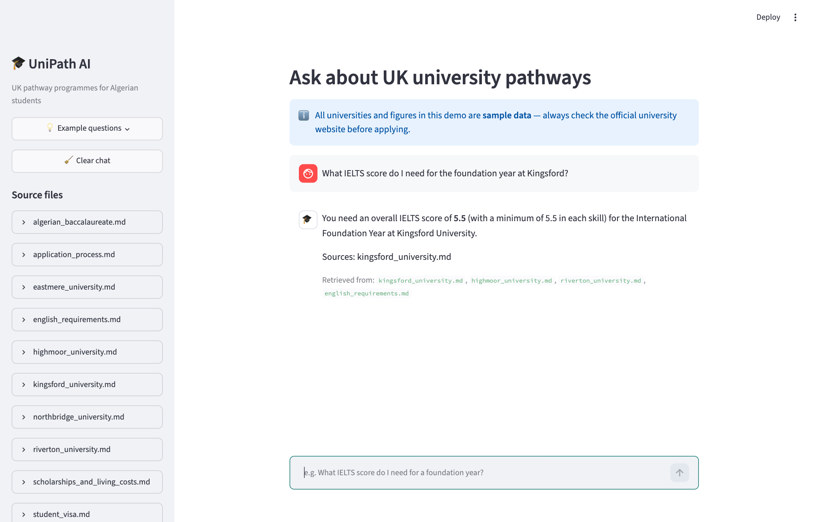
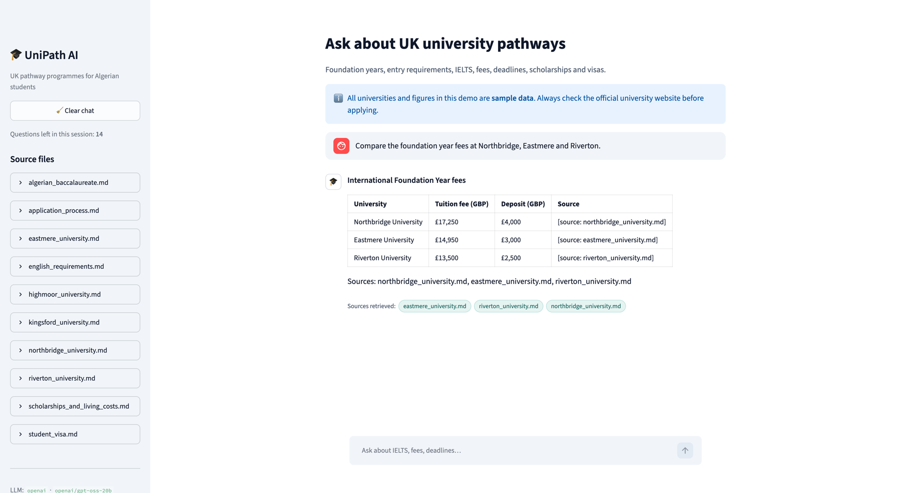
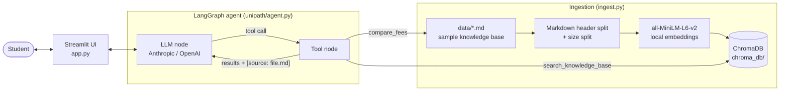

# 🎓 UniPath AI

**A RAG chatbot that answers questions about UK university pathway programmes for Algerian students** — foundation years, International Year One, pre-master's, entry requirements, IELTS scores, fees, deadlines, scholarships and visas.

Built with **LangGraph**, **LangChain**, **ChromaDB**, local **sentence-transformers** embeddings and **Streamlit**. Every answer cites the file it came from, and when the answer isn't in the knowledge base the assistant says so instead of guessing.

> ⚠️ All universities and figures in `data/` are **fictional sample data**. Replace them with real, verified information before using this for actual advice.

## Features

- **Retrieval-augmented answers** over a small markdown knowledge base (`data/`)
- **LangGraph agent** with two tools:
  - `search_knowledge_base(query)` — semantic search over the chunked documents
  - `compare_fees(universities)` — builds a fee comparison table parsed straight from the data files
- **Grounded & cited** — every answer ends with `Sources: file.md`; off-topic or unknown questions get *"I don't have that information in my knowledge base."*
- **Free local embeddings** (`all-MiniLM-L6-v2`), persisted Chroma vector store
- **Pluggable LLM** — Anthropic or OpenAI, chosen in `.env`
- **Streamlit chat UI** with chat history, source file browser and example questions
- **Evaluation script** (10 questions, accuracy score) and a **pytest** suite

## Screenshots

| Chat | Fee comparison |
|---|---|
|  |  |

<!-- Add your screenshots to docs/screenshots/ with these file names. -->

## Architecture



**How a question is answered**

1. The Streamlit app sends the question plus the chat history to the LangGraph agent.
2. The LLM decides which tool to call. `search_knowledge_base` returns the top chunks whose cosine relevance is above a threshold (otherwise `NO_RELEVANT_RESULTS`); `compare_fees` parses the `## Fees` tables from the university files.
3. Each tool result is tagged with `[source: file.md]`. The system prompt requires the LLM to answer only from tool results, cite the files, and refuse when the information isn't there.
4. The app shows the answer and the files that were retrieved.

## Project structure

```
UniPath/
├── app.py                  # Streamlit chat UI
├── ingest.py               # Build the Chroma vector store from data/
├── eval.py                 # 10-question evaluation, prints accuracy
├── data/                   # Markdown knowledge base (sample data — edit me)
├── unipath/
│   ├── config.py           # Settings from .env
│   ├── ingestion.py        # Load, chunk, embed, store
│   ├── fees.py             # Parse fee tables from markdown
│   ├── tools.py            # search_knowledge_base, compare_fees
│   └── agent.py            # LangGraph graph + system prompt
├── tests/                  # pytest suite
├── .streamlit/             # Theme + secrets template
├── requirements.txt
└── .env.example
```

## Setup

Requires **Python 3.11+**.

```bash
git clone https://github.com/okba-bouziane/UniPath.git
cd UniPath
python3 -m venv .venv
source .venv/bin/activate
pip install -r requirements.txt
cp .env.example .env   # then add your API key
```

In `.env`, set the provider and its key:

```env
LLM_PROVIDER=anthropic        # or: openai
ANTHROPIC_API_KEY=sk-ant-...
# OPENAI_API_KEY=sk-...
# LLM_MODEL=                  # optional override
```

Build the vector store and start the app:

```bash
python ingest.py
streamlit run app.py
```

The first run downloads the embedding model (~90 MB). If `chroma_db/` is missing, the app builds it automatically on startup.

## Editing the knowledge base

Edit or add markdown files in `data/`, then re-run `python ingest.py`.

For `compare_fees` to pick up a university, its file needs a `# University Name — ...` title and a `## Fees` section with a table:

```markdown
## Fees (sample data)

| Programme | Tuition fee (GBP) | Deposit (GBP) |
|---|---|---|
| International Foundation Year | 17,250 | 4,000 |
```

## Tests

```bash
pytest
```

Covers ingestion (loading, chunking, metadata, persistence), `search_knowledge_base` (correct file retrieved, off-topic queries rejected), `compare_fees` (parsing, name matching, unknown universities), the agent's tool loop (using a scripted fake LLM, so no API key is needed) and the eval grader.

## Evaluation

```bash
python eval.py                   # full agent eval — needs an API key
python eval.py --verbose         # also print every answer
python eval.py --retrieval-only  # no API key: checks the right file is retrieved
```

`eval.py` asks 10 questions with known answers. A question passes when the answer contains the expected facts **and** cites the expected source file. Two questions are deliberately outside the data (e.g. Oxford fees) and only pass if the agent declines to answer.

```
PASS  Q 1: What IELTS score do I need for the International Foundation Year at Kingsford?
...
Accuracy: 100% (10/10)
```

## Deploy free on Streamlit Community Cloud

1. Push this repo to GitHub (`chroma_db/` and `.env` are git-ignored — that's fine, the app builds the index on first start).
2. Go to [share.streamlit.io](https://share.streamlit.io), sign in with GitHub and click **Create app**.
3. Pick the repository, branch `main` and main file `app.py`.
4. Under **Advanced settings**, choose Python **3.11** or **3.12** and paste your secrets:
   ```toml
   LLM_PROVIDER = "anthropic"
   ANTHROPIC_API_KEY = "sk-ant-..."
   ```
   (see `.streamlit/secrets.toml.example`)
5. Click **Deploy**. The first build takes a few minutes because it installs PyTorch and downloads the embedding model.

**Troubleshooting:** if Chroma complains about an old SQLite version, add `pysqlite3-binary` to `requirements.txt` and put this at the very top of `app.py`:

```python
__import__("pysqlite3")
import sys
sys.modules["sqlite3"] = sys.modules.pop("pysqlite3")
```

## Possible improvements

- Hybrid search (BM25 + embeddings) and a reranker
- Streaming responses in the UI
- LLM-as-judge evaluation alongside keyword matching
- French and Arabic language support

## License

MIT
